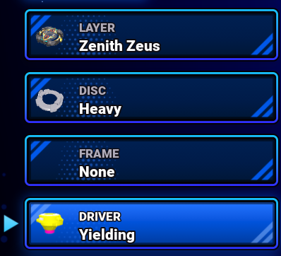
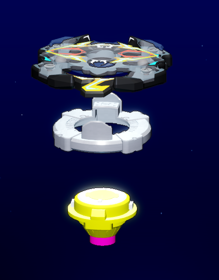
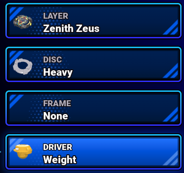
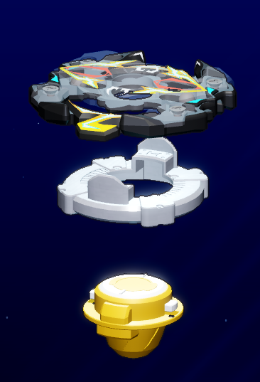
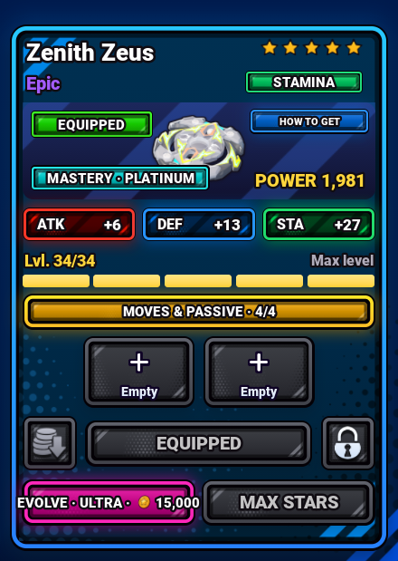
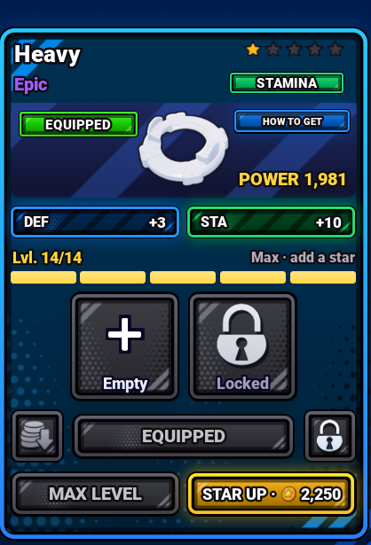
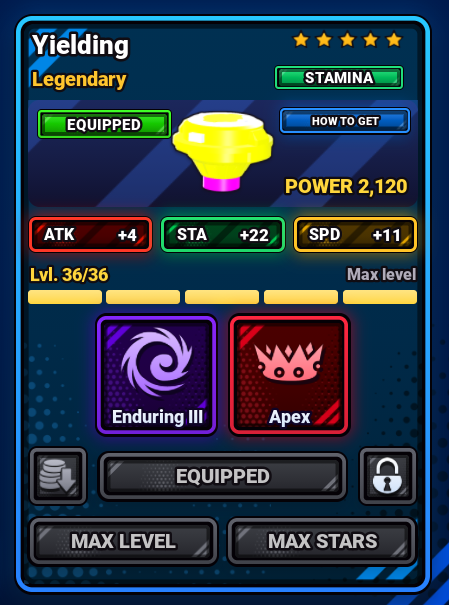

# Bey Rivals Macro

An **AFK macro for Bey Rivals on Roblox**, built with AutoHotkey v2 and a local Python vision helper (NotAILib). It automates supported boss-selection and battle inputs while Roblox is the active window.

**Estimated earnings:** approximately **200,000–500,000 in-game currency every 6–8 hours**, based on the creator's estimate. This is **not guaranteed**: rewards depend on your equipment, match outcomes, game updates, and uptime.

## Build Option 1 — Zenith Zeus / Heavy / Yielding

- **Layer:** Zenith Zeus
- **Disc:** Heavy
- **Frame:** None (as shown)
- **Driver:** Yielding
- **Upgrades:** **Preferably upgrade this build.** Higher levels/mastery can help its consistency.

## Build Option 2 — Zenith Zeus / Heavy / Weight

- **Layer:** Zenith Zeus
- **Disc:** Heavy
- **Frame:** None (as shown)
- **Driver:** Weight
- **Upgrades:** **Not strictly required**, but they may still help improve performance.

## My Favorite Build — Upgraded Zenith Zeus / Heavy / Yielding

My preferred setup uses **Zenith Zeus + Heavy + Yielding**. The three screenshots below show my equipped parts and their upgrades/levels. The frame slot is not equipped in the screenshots.

**Zenith Zeus — Layer**

**Heavy — Disc**

**Yielding — Driver**

## Running the macro

Download **BeyRivalsMacro.exe** from a release ZIP supplied by the creator. On first run, it checks for **AutoHotkey v2, Python, required Python packages**, and optional OCR support; missing software may be installed through Windows Package Manager (winget). An internet connection and approval of installation prompts may be required. After setup, the launcher opens the macro.

Use **F1** to start, **F2** to stop, **1–4** to preview a boss tab, **F4** to confirm and fight, and **Numpad5** to exit. The macro pauses its game inputs whenever Roblox is not the foreground window. Stopping the macro also closes its Python helper.

**Notes:** This is an unofficial fan project, not affiliated with Roblox or the Bey Rivals creators. Macro use may be restricted by game/platform rules. Review those rules before using it. Screen detection and timing are not guaranteed to work at every resolution or after game updates.
